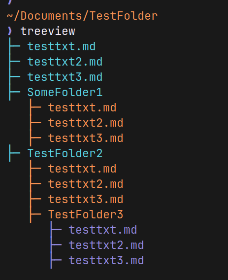

# Recursive Directory Tree Viewer

## Overview

---

I saw this video from Hayyoth (https://www.youtube.com/watch?v=tiMHtc6l7xM) and it inspired me to create my own using C#.

I added a color palette to show different depths and special symbols for indentation. 



## Note

---

To build this as a cli tool, I needed to added the follow to the ``.csproj``
```html
<PackAsTool>true</PackAsTool>
<ToolCommandName>treeview</ToolCommandName>
```

**Example:**
```html
<Project Sdk="Microsoft.NET.Sdk">
    <PropertyGroup>
        <OutputType>Exe</OutputType>
        <TargetFramework>net10.0</TargetFramework>
        
        <PackAsTool>true</PackAsTool>
        <ToolCommandName>treeview</ToolCommandName>
        
        <ImplicitUsings>enable</ImplicitUsings>
        <Nullable>enable</Nullable>
        <DockerDefaultTargetOS>Linux</DockerDefaultTargetOS>
    </PropertyGroup>
</Project>
```


## Build

---

Reference: https://linhgo.com/build-net-cli-tool-with-net-8/

To turn this into a distributable package:
```bash
dotnet pack -c Release
```
This creates a .nupkg file (basically a zip with your tool inside) at:
```bash
bin/Release/DirectoryTreeViewer.1.0.0.nupkg
```

Think of this as your tool’s installation package - like a ``.deb`` file for Ubuntu or an ``.msi`` for Windows.

## To install the CLI tool Globally

Now let’s install it system-wide so you can use it from anywhere:
```bash
dotnet tool install --global --add-source ./bin/Release DirectoryTreeViewer
```

**What this does:**
- ``--global`` makes it available everywhere (not just in this folder)
- ``--add-source`` ./bin/Release tells .NET where to find your .nupkg file

Once installed, the tool is added to your PATH automatically. You can now use it from any directory.

## Example Usage

---

**Use current path (No arguments):**
```bash
> cd SomeDirectory
> treeview
```

**Use argument path:**
```bash
treeview ~/SomeDirectory
```
